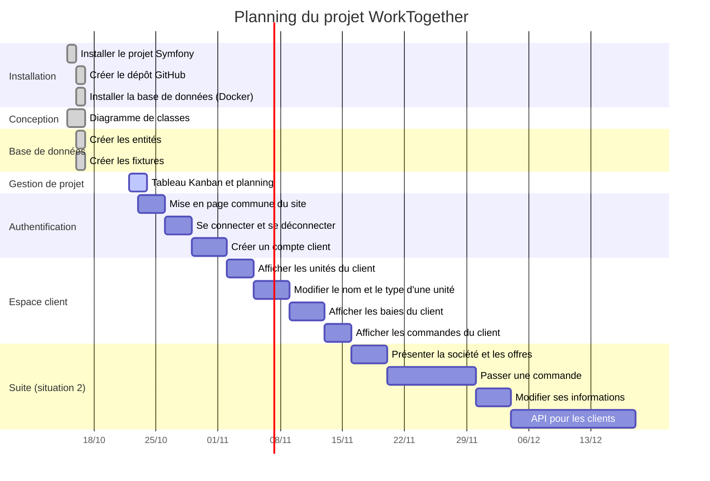

# Gestion de projet – WorkTogether

- Dépôt GitHub : https://github.com/LucasChaudet/Worktogether-leger
- Tableau Kanban (GitHub Project) : https://github.com/users/LucasChaudet/projects/2

## Outils utilisés

| Outil | À quoi il sert |
|---|---|
| **Issues GitHub** | Une issue = une tâche. Elle contient la liste des étapes à faire (cases à cocher). |
| **Labels** | Ranger les tâches par thème (installation, base de données, authentification...). |
| **GitHub Project (Kanban)** | Voir où en est chaque tâche : à faire, en cours, terminée. |
| **Vue Roadmap (Gantt)** | Voir les tâches sur un calendrier grâce aux dates de début et de fin. |

## Fonctionnement du Kanban

Le tableau a trois colonnes :

- **Todo** : la tâche est prévue mais pas commencée.
- **In Progress** : je travaille dessus en ce moment.
- **Done** : la tâche est terminée.

Règles que je suis :

1. Je ne travaille que sur une ou deux tâches à la fois (colonne In Progress).
2. Quand je commence une tâche, je la déplace dans In Progress.
3. Quand toutes les cases de la tâche sont cochées, je ferme l'issue : elle passe dans Done.
4. Je mets le tableau à jour à chaque séance.

## Découpage du projet

Le travail demandé est découpé en 5 grandes parties, puis en tâches plus petites.

| N° | Partie | Tâche | Statut |
|---|---|---|---|
| 1 | Installation | Installer le projet Symfony | Terminée |
| 2 | Installation | Créer le dépôt GitHub | Terminée |
| 3 | Conception | Faire le diagramme de classes | Terminée |
| 4 | Installation | Installer la base de données avec Docker | Terminée |
| 5 | Base de données | Créer les entités | Terminée |
| 6 | Base de données | Créer les fixtures | Terminée |
| 7 | Gestion de projet | Organiser le projet dans un tableau Kanban | En cours |
| 8 | Espace client | Faire la mise en page commune du site | À faire |
| 9 | Authentification | Se connecter et se déconnecter | À faire |
| 10 | Authentification | Créer un compte client | À faire |
| 11 | Espace client | Afficher les unités du client | À faire |
| 12 | Espace client | Modifier le nom et le type d'une unité | À faire |
| 13 | Espace client | Afficher les baies du client | À faire |
| 14 | Espace client | Afficher les commandes du client | À faire |
| 15 | Suite (situation 2) | Présenter la société et les offres | À faire |
| 16 | Suite (situation 2) | Passer une commande | À faire |
| 17 | Suite (situation 2) | Modifier ses informations personnelles | À faire |
| 18 | Suite (situation 2) | Créer l'API pour les clients | À faire |

Les tâches 1 à 14 correspondent au travail demandé pour démarrer le projet. Les tâches 15 à 18 préparent la suite de la situation professionnelle 2.

## Planning (Gantt)

Les dates sont des prévisions : je les ajuste dans le GitHub Project si une tâche prend plus ou moins de temps que prévu.
